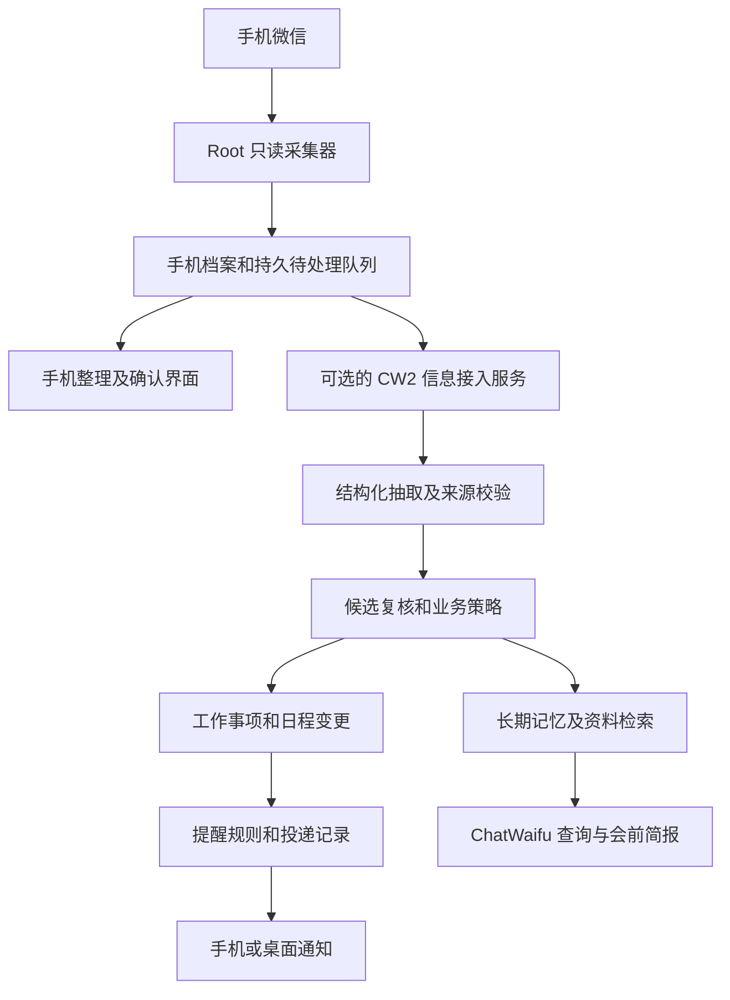

# 个人信息整理系统技术选型

日期：2026-10-12。适用目标：安卓独立采集微信，整理长期记忆、任务、日程和可能遗漏的事项，随后接入 ChatWaifu 与消息推送。

建议保留手机独立采集和本地收件箱，以现有 ChatWaifu 的记忆与个人助理服务作为可选的集中整理后端。首版采用原生 Android、SQLite、结构化模型输出和已有调度；资料类型增加后再引入 LlamaIndex 或 Haystack，人物关系与历史事实查询确有需求后再评估 Graphiti。Mem0 和 LangMem 适合做抽取与检索对照实验，暂不替换现有记忆系统。

以下选择是基于现有源码和官方资料的工程判断。运行成本、中文抽取效果与设备耗电仍需同一测试集验证，不能用框架公开榜单推导本项目的效果。

## 需求与数据对象

[场景目录](personal-information-user-scenarios-2026-10-12.md)包含 42 个场景假设。技术实现需要分别表达六类对象：

| 对象     | 保存什么                                       | 主要行为                               |
| -------- | ---------------------------------------------- | -------------------------------------- |
| 原始资料 | 消息原文、来源身份、时间、修订和附件引用       | 增量采集、查证、历史补采、检索         |
| 长期记忆 | 事实、偏好、人物职责、项目决定、经验           | 提议、确认、去重、更正、失效、遗忘     |
| 任务     | 动作、负责人、交付物、截止、等待对象、完成证据 | 待确认、待执行、等待、阻塞、完成、取消 |
| 日程     | 已约定的时间段、地点、参与人、外部记录身份     | 创建、改期、取消、冲突检查             |
| 提醒     | 提示条件、提前量、目标设备、有效窗口           | 排程、投递、展示、关闭、贪睡、过期     |
| 计划     | 优先级、估计时长、依赖、可用时间和建议工作块   | 生成建议、用户调整、复盘               |

“周四六点聚餐，我订位，小李不吃辣”可同时产生日程、订位任务和小李的偏好；“改周五六点半”应修订同一日程并撤销旧提醒。保存摘要或向量不能完成这套状态更新。

个人事实放入经过授权的个人范围；角色自己的经历和设定仍归角色记忆。日程和任务保留各自的业务状态，不能把所有待办都写成永久人格记忆。

## 当前可以复用的实现

| 部分                   | 当前源码能力                                                                     | 本目标仍需补齐                                                                 |
| ---------------------- | -------------------------------------------------------------------------------- | ------------------------------------------------------------------------------ |
| 安卓采集器和信息收件箱 | Root 只读采集、原文档案、本地确认记忆、兼容模型接口、人工或可选定时整理          | 新批次触发、持久处理队列、历史回填、跨设备同步、任务状态和本地提醒             |
| 安卓 AI 整理           | 当前从近七天未处理的文字消息中选最早一批，最多 30 条；模型实际输入另有长度限制   | 连续会话上下文、历史与新增分开的游标、变化消息重处理、语音及附件理解           |
| CW2 长期记忆           | 提案、策略、来源、主体、有效期、替代和删除状态；FTS 与语义检索及上下文预算       | 微信档案的独立来源契约和接入入口；角色对话抽取不能直接当作导入器               |
| CW2 语义索引           | SQLite 保存模型指纹和向量，索引可重建；容器已接入实际实现                        | 大档案的切块和索引策略；当前按范围读取向量并在进程中算相似度，扩大量前需测延迟 |
| CW2 时间图谱           | 已有 TemporalMemoryGraph 接口                                                    | 当前默认空实现；Graphiti 尚未接入                                              |
| CW2 日程与投递         | Google Calendar、Google Tasks、Mac EventKit 适配器；持久提醒、投递记录、设备回执 | 安卓投递端；聊天改期与提醒规则联动；完整工作任务与等待事项模型                 |

这些是源码能力，不能据此推断当前服务器、手机深度休眠或原生通知均已完成验收。现有安卓 App 是 Java 和原生 Views 的原型，尚未使用下文建议的 Compose、Room、WorkManager。

尤其要区分 CW2 的 TaskInput 与工作任务：当前 TaskInput 的 kind 是 reminder 或 alarm，主要表达到时提醒；它没有完整的负责人、依赖、预计工时和等待状态。Google Tasks 是另一个已有适配器。我们应复用提醒调度，另外补充工作事项的业务模型和关联。

源码依据：[记忆契约](../../packages/protocol-python/src/chatwaifu_protocol/memory.py)、[记忆服务](../../services/runtime/src/chatwaifu_runtime/memory/service.py)、[检索](../../services/runtime/src/chatwaifu_runtime/memory/retrieval.py)、[语义索引](../../services/runtime/src/chatwaifu_runtime/memory/semantic_index.py)、[容器接入](../../services/runtime/src/chatwaifu_runtime/bootstrap/container.py)、[提醒服务](../../services/runtime/src/chatwaifu_runtime/personal_assistant/tasks.py)、[设备接口](../../services/runtime/src/chatwaifu_runtime/api/personal_assistant_routes.py)。架构约束见 [ADR 0008](../adr/0008-event-sourced-memory.md)、[ADR 0010](../adr/0010-sqlite-first.md)、[ADR 0057](../adr/0057-native-apple-and-durable-reminders.md) 和 [ADR 0058](../adr/0058-account-owned-unified-agenda.md)。

## 推荐的技术组成

| 层             | 首选                                                                   | 选择理由和限制                                                                      |
| -------------- | ---------------------------------------------------------------------- | ----------------------------------------------------------------------------------- |
| 手机应用       | Android 原生；新增复杂界面逐步用 Kotlin、Compose；转为标准 Gradle 工程 | Root、启动恢复、后台工作和通知均需原生能力；保留可用 Java 代码和采集器，分步迁移    |
| 手机业务存储   | SQLite，逐步通过 Room 管理 App 自己的库                                | 原文引用、建议、任务和同步队列离线可用；Room 不负责读取或解密微信源库               |
| 采集边界       | 保留独立 Root 采集器与 SQLCipher 适配                                  | 微信版本变化集中在采集适配器；UI 和第三方框架不直接依赖微信表结构                   |
| API 和业务服务 | 复用 CW2 Python 3.12、FastAPI、Pydantic 与领域接口                     | 不增加另一套服务端语言和权限系统；新增版本化的个人信息接入契约                      |
| AI 接口        | 可替换的 OpenAI 兼容适配器；抽取、总结、Embedding 分开配置             | JSON Schema 可用时启用；无原生约束时仍严格本地验证，失败不推进处理状态              |
| 记忆           | 复用 CW2 的候选、策略、确认、来源及更正链路                            | 外部记忆库作为可替换组件评估；个人事实是否生效由业务规则决定                        |
| 检索           | SQLite FTS5 加现有语义投影                                             | 先评估中文、人名、别名和数字匹配；现有 FTS 搜索词已有中文双字处理，无需从零增加分词 |
| 队列和恢复     | 持久任务表、事务性 outbox、批次租约、有限并发与退避                    | outbox 是和资料一起提交的待处理记录；进程重启可以继续处理，API 重试不会重复建任务   |
| 时间和任务     | 明确日期字段、IANA 时区、状态修订；复用现有提醒调度                    | 截止时间、计划时间、日程起止、提醒时间分别保存；相对日期按原消息时间解释            |
| 通知           | Android Notification 与 AlarmManager；服务端通知可选 ntfy 或 FCM       | 手机已接收的明确提醒可本地排程；网络推送只是一个投递适配器                          |
| 部署           | 手机可独立使用；集中模式复用 CW2 常驻 Runtime                          | 首版无需 Redis、Celery、独立图数据库或微服务集群                                    |

[Compose](https://developer.android.com/compose)是 Android 推荐的原生 UI 工具；[Room](https://developer.android.com/training/data-storage/room)为 SQLite 提供 SQL 编译检查和迁移支持。Android 官方区分[持久后台工作](https://developer.android.com/develop/background-work/background-tasks/persistent/getting-started/define-work)与[按时间提醒](https://developer.android.com/develop/background-work/services/alarms)。

### 新消息触发与定时处理

建议采用“新采集批次触发加周期补偿”：消息先可靠入库，随后按会话短时间合并，异步抽取；没有触发信号或联网失败时，周期任务补处理。合并窗口和紧急事项的最大等待时间作为用户设置，初始数值通过耗电、费用和漏检测试确定。

采集游标、上传游标、模型处理记录分别保存。去重依赖来源账号、稳定消息身份和内容修订，不能只比较标题。一个处理中批次需要租约；只有建议和实际处理的来源记录成功提交后才能推进状态。关键词可以提高调度优先级，不能成为唯一过滤条件，否则表达隐晦的承诺容易漏掉。

WorkManager 的周期任务最小间隔是 15 分钟，实际时间受系统优化影响，适合作为补偿。明确时间的用户提醒走 AlarmManager，精确提醒按需要取得系统特别授权。Root 也不意味着 CPU 在深度休眠中持续运行，实时性和耗电需在这台手机验证。[Android 后台工作](https://developer.android.com/develop/background-work/background-tasks/persistent/getting-started/define-work)、[提醒 API](https://developer.android.com/develop/background-work/services/alarms)。

### 接入 ChatWaifu 的方式

微信档案不宜提交到普通聊天渠道并让角色逐条回复。新增只读来源接入入口，按可信账号和设备映射 owner 范围，保存 sender、conversation、message、observed_at、revision 和来源引用；模型不能自行指定更高权限的 namespace。

现有 MemorySource.source_kind 未包含微信档案导入，个人助理设备 SourceSelection 也只有 calendar 和 reminder。接入时需要扩展相应契约，不能仅把 App 指向一个已有 URL 就宣称完成集成。

云端集中模式让 CW2 负责业务状态和模型密钥；手机独立模式继续使用手机安全存储中的兼容接口配置。两种模式通过相同对象契约互通，同一对象有明确权威来源与版本，避免手机和服务器各自反复抽取、互相覆盖。

## 当前候选框架比较

以下接入成本是相对当前代码的判断，非工时或性能测量。许可证列为上游核心仓库标识，依赖、数据库与托管服务分别核查。

| 候选                 | 擅长的职责                       | 优点                                                               | 对我们主要的不足                                                                                | 本项目结论                                           |
| -------------------- | -------------------------------- | ------------------------------------------------------------------ | ----------------------------------------------------------------------------------------------- | ---------------------------------------------------- |
| Mem0，Apache 2.0     | 事实抽取、持久记忆及检索         | add/search 接口容易试验；模型和存储可配置；已有实体与时间相关处理  | 与 CW2 记忆状态和索引重叠；原文证据、人物归属、确认、删除传播仍需接入；不能替代任务状态机       | 使用独立测试库做对照实验，效果明确改善后再适配       |
| Graphiti，Apache 2.0 | 随时间变化的人物和关系事实       | 保留事件背景、关系时间和历史有效性；适合“当时谁负责、后来怎么变了” | 增加图存储和抽取依赖；结构化输出质量影响入图；时间图谱不承担任务执行或通知                      | 第二阶段针对关系与历史查询评估，不把全部聊天立即入图 |
| LlamaIndex，MIT      | 多来源资料接入、转换、索引和检索 | 可复用切块、连接器、缓存、文档 ID 与哈希更新                       | 它的索引和工作流能力仍需业务规则；不能自动认定承诺、完成或安排已经确认                          | 多类型资料增多时优先作为资料层组件，限定使用范围     |
| LangGraph，MIT       | 有状态 AI 工作流和人工介入       | 检查点、恢复、分支流程及跨流程 Store；适合多轮复核                 | 要配置持久存储、清理和副作用幂等；不自动提供我们的来源策略或手机提醒；现有简单流程接入收益有限  | 多步骤人工审批与恢复成为痛点时再用                   |
| Open Notebook，MIT   | 完整资料工作台                   | 已有资料管理、笔记、来源对话和检索；支持兼容模型端点               | 自带 UI、API、后台 worker 与 SurrealDB，和 CW2 重叠；微信和工作事项联动要另写                   | 希望快速拥有独立资料工作台时可选，作为外部资料服务   |
| Khoj，AGPL 3.0       | 完整个人知识助手                 | 可以直接使用自托管检索和问答产品，减少从零设计工作台               | 和 ChatWaifu 的助手入口重叠；采集接入、细致业务状态与原生提醒需评估；许可证不同于 MIT 或 Apache | 愿意直接采用其产品体系时考虑，不作为默认内嵌基础库   |

Mem0 当前自动抽取是追加事实，更正或删除可走显式操作；当前核心文档还区分了 Platform 内建图关联和 OSS 实体匹配。不能把旧图后端教程或托管版榜单视作当前开源 SDK 的保证。[当前机制](https://docs.mem0.ai/core-concepts/how-it-works)、[上游仓库](https://github.com/mem0ai/mem0)。因此本报告调整了早先“先评估 Mem0”的顺序：先验证已有 CW2 抽取，再把 Mem0 作为替代候选。

Graphiti 当前支持 Neo4j、FalkorDB 等后端，FalkorDB Lite 为可评估的嵌入式路径；Kuzu 已被其上游标为弃用。默认模型、Embedding 和 OpenAI 兼容端点需要分别验证，尤其是中文主体匹配和结构化输出。[Graphiti 安装与模型说明](https://github.com/getzep/graphiti#installation)。

LlamaIndex 的文档 ID 和内容哈希管理能减少重复资料处理，适合原始资料索引。[IngestionPipeline](https://developers.llamaindex.ai/python/framework/module_guides/loading/ingestion_pipeline/)。LangGraph 的 checkpointer 保存流程状态，Store 保存跨流程数据；这些存储设施需要配合自己的业务策略。[Persistence](https://docs.langchain.com/oss/python/langgraph/persistence)。完整应用能力见 [Open Notebook](https://github.com/lfnovo/open-notebook) 与 [Khoj](https://docs.khoj.dev/)，Khoj 许可证见[仓库](https://github.com/khoj-ai/khoj)。

### 运行负担与兼容接口

LlamaIndex、Haystack、LangGraph 和 LangMem 可以作为 Python 库使用，不必各自新建服务。实际运行负担取决于选用的模型、存储和恢复方案。Mem0 SDK 的存储也取决于配置，不能把完整自托管服务的部署负担直接套到 SDK 使用上。Graphiti 额外引入图存储及图抽取，完整知识库应用则增加独立产品和数据库的维护。这是部署结构判断，尚未测量资源占用。

模型费用按抽取、总结、Embedding、重排和失败重试分别统计。同样处理一批消息，不同框架可能触发不同数量的请求。先小批量处理有价值的材料，避免一次导入所有历史资料后才发现费用或误报过高。

兼容接口验收需要分别检查聊天生成、结构化输出、Embedding、模型路由和限流恢复。只有聊天端点可用的供应商，可以承担抽取，但不能据此认定向量检索也可用；Embedding 可选择另一个服务。JSON 模式只保证格式时，本地仍须验证来源、人物归属、日期和操作对象。

## 其他可行方案

| 方案                   | 可以解决的需求                                           | 代价和采用条件                                                                                      |
| ---------------------- | -------------------------------------------------------- | --------------------------------------------------------------------------------------------------- |
| 继续扩展 CW2           | 同时保留当前角色、个人助理、模型配置、记忆确认和出处体系 | 业务规则和评估集需要自己维护；当前最省重复建设，推荐作为主线                                        |
| LangMem                | 对话抽取、背景记忆整理、用户资料和情景记忆               | 可用独立函数，也可结合 LangGraph Store；仍须适配 CW2 权限、来源及更正。适合作为 Mem0 的另一对照候选 |
| Haystack               | 组件化资料接入、检索、重排、分支处理                     | 适合明确的数据管线；是 LlamaIndex 的替代选择，两者无需同时引入                                      |
| Letta                  | 自带持久状态、可编辑记忆块和上下文管理的 Agent           | 适合重新选择 Agent Runtime 的路线；目前会和 ChatWaifu 的角色及上下文体系产生较大重叠                |
| n8n                    | 邮件、Webhook、日历与推送等外部系统连接                  | 适合外围自动化；核心事实和工作事项状态由业务服务负责，避免工作流和 Runtime 竞争排程权威             |
| Temporal               | 多 worker 的长期流程恢复、等待和持久定时器               | 服务端部署与维护增加；多服务、长流程恢复或高可用有明确需求时采用。可靠定时器仍不保证手机准时展示    |
| PostgreSQL 加 pgvector | 共享业务状态与向量检索、多进程部署                       | 增加数据库服务和迁移；并发写入或高可用要求出现后评估，替换 SQLite 需 ADR 和基准                     |
| Qdrant                 | 独立向量检索与元数据过滤                                 | 作为可重建索引；不能替代事实版本、原文档案、任务状态或访问策略。当前线性相似度成为实测瓶颈时评估    |
| OR-Tools               | 有截止、时长、依赖和空闲时间约束的排程                   | 适合后续工作块建议；先保证输入完整，首版规则排序即可，AI 负责解释和提议                             |

[LangMem](https://langchain-ai.github.io/langmem/)同时提供可用于自定义存储的函数与 LangGraph 集成；[Haystack](https://docs.haystack.deepset.ai/docs/pipelines)提供可组合数据管线；[Letta](https://docs.letta.com/v1-sdk/concepts/stateful-agents)提供持久 Agent 与记忆块。它们解决的层不同，接入一个并不会自动补齐全部 42 个场景。

[n8n 自托管](https://docs.n8n.io/deploy/host-n8n.md)适合连接外围系统，其核心代码使用 [Sustainable Use License](https://github.com/n8n-io/n8n/blob/master/LICENSE.md)，不要把它与 MIT 库一并称为同一种开放许可。[Temporal 的持久定时器](https://docs.temporal.io/workflow-execution/timers-delays)在服务恢复后继续执行，业务仍需决定过期提醒是否作废。[pgvector](https://github.com/pgvector/pgvector)、[Qdrant 过滤](https://qdrant.tech/documentation/search/filtering/)和 [OR-Tools 排程](https://developers.google.com/optimization/scheduling)分别对应数据、索引和约束求解。

## 安卓界面与运行路线

| 界面方案          | 优势                                                 | 本项目代价                                                                | 判断                                 |
| ----------------- | ---------------------------------------------------- | ------------------------------------------------------------------------- | ------------------------------------ |
| Kotlin 和 Compose | Android 系统能力直接接入；原生后台和通知代码集中维护 | 当前 Java Views 原型需要分步迁移                                          | 首选，先标准工程和数据层，再迁移界面 |
| React Native      | 可复用部分 TypeScript 类型、前端经验和业务逻辑       | Root、启动恢复、AlarmManager 仍需原生模块；现有 React Web UI 不能直接照搬 | 明确需要跨平台手机客户端时再考虑     |
| Flutter           | 跨平台 UI 一致，适合独立客户端                       | 增加 Dart 技术栈和原生能力桥接；当前微信 Root 采集仍仅安卓适用            | 当前不优先                           |

界面路线的判断主要来自我们需要维护的系统能力及现有代码，并非三者性能比较。

| 运行方式                                   | 是否依赖电脑                         | 优点                                            | 限制                                                                                       |
| ------------------------------------------ | ------------------------------------ | ----------------------------------------------- | ------------------------------------------------------------------------------------------ |
| 手机存储与整理，调用兼容模型 API           | 不依赖电脑；AI 需要网络和模型服务    | 延续当前 App，离线仍可查看、确认和提醒          | 跨来源知识整合及复杂工作流需要手机实现；需要测电量与请求费用                               |
| 手机采集与离线收件箱，CW2 常驻后端集中整理 | 不依赖这台 Mac；集中处理依赖后端在线 | 复用 CW2 能力，资料统一，方便以后从角色对话查询 | 同步、设备配对与安卓提醒协议需要完成；后端故障时手机保留待处理队列                         |
| 手机运行本地模型                           | 不依赖电脑，也可不依赖云端模型       | 数据与推理留在手机                              | 模型质量、内存、温度、耗电、Embedding 和结构化输出需真机评估；当前没有证据支持作为默认方案 |
| 完整知识助手加独立采集连接器               | 取决于应用部署方式                   | 快速获得成熟的资料 UI                           | 收件箱、工作事项、ChatWaifu 与源数据往往要额外整合                                         |

建议产品先保留第一种能力，再增加第二种可选模式。独立采集不应因 ChatWaifu 或电脑关机而停止。集中处理端是增值能力，手机保留已确认资料和已同步的提醒。

## 推送与提醒的取舍

手机本地已知的明确时间提醒优先本地排程，避免完全依赖网络唤醒。服务端产生的新建议、每日简报和资料变更可通过推送通知手机重新读取结果。

- App 自带通知适合直接确认、关闭、贪睡和打开原文，建议作为主要交互入口。
- ntfy 可以自托管，通过 HTTP 发布通知并提供动作按钮，适合先验证推送链路；认证与最终业务回执仍由我们处理。[ntfy](https://docs.ntfy.sh/publish/)。
- FCM 适合兼容 Google Play 服务的设备；这台手机的 GMS 和网络可达性要核验后再选择。[FCM Android 要求](https://firebase.google.com/docs/cloud-messaging/android/get-started)。

投递系统要分别记录服务接受、设备接收、已展示、用户处理和任务完成。关闭通知不等于完成任务，服务返回成功也不等于用户看到。服务器和手机使用同一个 occurrence ID 与修订去重；已经排入手机的规则如果在离线期间被远程改期或取消，需要重连校正，并呈现当前同步状态。

## 实施顺序与选型验收

### 第一阶段 微信到行动的完整流程

1. 标准化安卓工程，保留采集器、原文和已有确认界面；补持久处理队列、新批次触发和历史补采入口。
2. 建立有来源引用的事实、工作任务、日程和提醒候选；本人、他人、引用内容和模型推测分别标注。
3. 补复核与修订：能确认、忽略、纠正，并把后续的完成、取消和改期消息关联到同一事项。
4. 提供今日摘要、待回复、等待别人、临近截止和重要变更视图，再接本地通知。

这一阶段无需新增重量级框架。普通字段校验可直接采用 JSON Schema 和 Pydantic；任务状态变更、日期校验和投递去重使用确定性规则。模型只产生候选和解释，执行由业务服务负责。

### 第二阶段 ChatWaifu 与资料检索

补独立的信息源接入协议、设备配对、同步和删除传播，把经过策略处理的个人资料与记忆提供给 ChatWaifu；按新来源需求选择 LlamaIndex 或 Haystack。语音、OCR、文件解析分别作为资料适配器，不能把只有路径或文件名的消息视作附件内容已经读取。

### 第三阶段 有证据的增强

使用同一中文场景集，对比现有抽取、Mem0、LangMem；对涉及关系历史的问题再测试 Graphiti。复杂人工流程考虑 LangGraph，多服务持久流程考虑 Temporal，约束排程考虑 OR-Tools。数据库更换由实测延迟、并发和运维需求决定。

框架试验使用独立数据与固定依赖版本。Mem0 的 add 通常包含其自身的存储流程，不能假设它提供无写入、带我们全部证据字段的候选接口；若做侧影试验应隔离存储，并验证源 ID 映射、更正和删除，而不是调用未稳定的内部方法接管生产写入。

验收集至少覆盖：同名与别名人物、群里给别人的任务、本人承诺、讨论与最终决定、相对日期、改期取消、重复输入、后续完成证据、历史失效、无关检索、删除传播、消息中的恶意指令、断网重试、进程重启和手机深度休眠。

| 关注指标         | 如何判断                                                           |
| ---------------- | ------------------------------------------------------------------ |
| 重要事项漏检     | 预先标注的承诺、截止和变更是否被发现                               |
| 误报和打扰       | 生成了多少无责任归属、重复或无行动价值的提示                       |
| 来源和主体正确性 | 候选是否都引用真实输入；他人事实是否错误归到本人                   |
| 状态正确性       | 改期后是否留下旧提醒；取消、完成、忽略是否串到其他事项             |
| 记忆检索         | 当前事实、历史事实和找不到答案时是否返回合适证据                   |
| 运行成本         | 每批模型调用、Token、耗时、失败重试及手机电量                      |
| 恢复和投递       | 重启不丢处理记录；重复输入不重复建事项；设备展示与服务投递分别核对 |

最终技术选择是：Android 原生加 SQLite，CW2 FastAPI 与记忆/个人助理服务，兼容模型适配器，以及确定性的事项和提醒状态管理。LlamaIndex、Graphiti、LangGraph 等保留替换位置，按照它们能改善的具体场景逐项引入。
